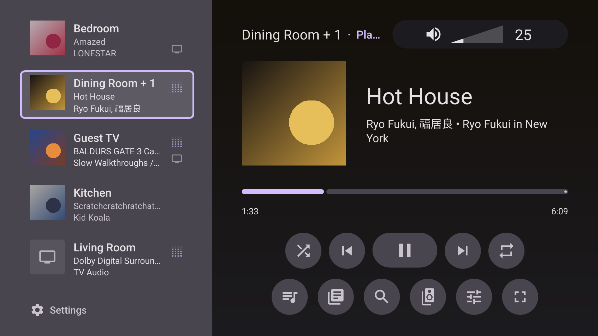

# x2rock for the Steam Deck

A Sonos controller for the Steam Deck, Linux desktops and Windows tablets, in the look of
[x2rock for Android TV](https://github.com/rahga/x2rocktv): every room down the left with what
it is playing, the selected room's player on the right, driven by a gamepad, a keyboard or a
finger.

It talks to the speakers directly over the local network, with **no Sonos account and no
polling**: it subscribes, and the speakers push every change. The Sonos layer is the
[x2rock](https://github.com/rahga/x2rock) CLI's own, used as a library, so the two find,
play and search the same way.



## Status (as of 2026-10-30)

x2rock-deck has been developed on Linux desktops and verified read-only against a single-room
Sonos household (Media Room, 2026-10-30). **It has not yet been run on physical Steam Deck
hardware, a Windows tablet, or a multi-room household.** The Windows binary has only been built
in CI. Physical hardware checks (gamepad feel and repeats on the Deck, Steam shortcuts and modes,
Windows touch, multi-room grouping barriers, soundbars, Line-In) are tracked in
[#7](https://github.com/rahga/x2rock/issues/7).

## What it does

- **Rooms**: play, pause, skip, seek, shuffle, repeat; volume per room and per speaker, by
  steps that climb as a key is held; grouping, Play everywhere, and moving a room in the list.
  Next and Prev name where they go.
- **Music**: Sonos favourites and playlists, the queue, internet radio, a service's own pages,
  and one search across every service the household can use (a new search, or leaving Search,
  stops the one before asking the services it has not heard from). A song, album or playlist can be
  added to or removed from Sonos favourites, and a book opened on the chapter it resumes at.
- **TV**: switching a room to its soundbar's TV input, Night Sound and Speech Enhancement.
- **Room settings**: the sleep timer, bass, treble, loudness, TruePlay, crossfade, a Sub's and
  surrounds' levels, the status light, touch controls, a soundbar's remote feedback light and
  IR repeater, and "This is my TV".
- **The household**: its alarms, made, changed and removed here, and which speakers have an
  update waiting.
- **Beta features**, behind a switch in Settings as on the TV: Line-In, and Send a report, a QR
  code that opens a prefilled GitHub issue on a phone.
- **Six dark themes**, one of them taken from the cover playing.

Cover fetching and decoding share a limit of four active loads. More covers wait
for a slot, so a list of results cannot start a decode for every row at once.
Completed pixels retain their slot until the UI accepts them, bounding that
handoff queue too.
Decoded cover pixels have a 64 MiB cache budget. Room and list thumbnails decode
at up to 168×168 pixels (56 dp at 3× scale); pane, Now Playing and player-bar art
keep up to 512×512. The cache distinguishes URL and size, so small thumbnails
do not replace full artwork. The budget holds roughly 590 maximum-size
thumbnails, fewer when full covers are also retained. Eviction uses render
recency and protects current model images. If an unusually large model still
exceeds the budget, extra covers wait as placeholders and retry in row order
when space is available. GPU copies and active decode scratch are outside
this budget.
Failed covers retry after 30 seconds for transient errors, or 30 minutes for
HTTP 404/410, refused URLs and undecodable images. Displayed failures have their
own retry timer, including while playback is paused; expired hidden failures
are removed from the retry history.

Commands sent to a speaker or group run in dedicated per-target lanes, so rapid
volume, tone or seek steps execute in sequence without blocking reads. Grouping
and topology mutations synchronize across a barrier that waits for earlier
operations in every lane to settle and holds back later work before applying the
change.

Asynchronous fetches carry monotonic request identities, so late replies from a
closed screen or older search never overwrite the current view. When the app
reconnects to speakers, only pending requests for active screens are re-issued.

## Installing

- **Steam Deck and Linux**: [docs/install-on-steam-deck.md](docs/install-on-steam-deck.md).
  Unpack the release and run `./install.sh`; it adds the app to Steam for Gaming Mode.
- **Windows**: [docs/install-on-windows.md](docs/install-on-windows.md). Unzip and run
  `x2rock-deck.exe`.

There is no Flatpak, on purpose: one self-contained binary per platform, installed for the
current user only. Since a plain binary does not update itself, the app asks GitHub once a
launch whether a newer release is out and says so if one is; it sends nothing else, and
**Settings > This app > Look for updates** turns it off.

## Controls

| Gamepad | Keyboard | Does |
|---|---|---|
| D-pad, left stick | Arrows | Move |
| A | Enter | Select; held, the TV remote's long press |
| B | Esc, Backspace | Back |
| Y, Start | Tab, M | Menu: a row's actions, the exact volume |
| X | Space | Play or pause the selected room |
| LB / RB | `-` / `=` | The selected room's volume |
| LT / RT | `[` / `]`, PgUp / PgDn | Previous / next track |
| View | F11 | Full screen |

Held gamepad directions and LB/RB repeat after 400 ms, then every 90 ms. A held volume
control (LB/RB, `-`/`=`, or Left/Right on a volume bar) steps 2, 3, then 5 at most every
250 ms and moves at most 20 per hold; release and press again to go further. Group volume
is sent as a level, so a newer one replaces any still waiting; after release, nothing
arrives beyond the last level asked for. Each pad tracks its own held controls. Disconnecting a pad
releases its held actions and stops its repeats. Incoming axis noise does not delay repeats.

Search has its own keyboard on screen, walked with the pad; a real keyboard types into it too,
and Steam's (Steam + X in Gaming Mode) is intended to type into it as well.

## Building

You need Rust (1.92 or newer). The deck is the `deck/` member of the x2rock repository and
uses the x2rock package at its root as a library, with the CLI left out. Build it by name from
the repository root: a plain `cargo build` there is the CLI alone.

```sh
git clone https://github.com/rahga/x2rock && cd x2rock
cargo build --profile release-deck -p x2rock-deck
./target/release-deck/x2rock-deck --demo                # no speakers needed
```

`release-deck` is the workspace's release profile with full optimisation and unwinding: the
deck recovers from a panicked task, which x2rock's own `release` (abort) would not allow.

On Linux the build needs fontconfig, xkbcommon, wayland, udev and OpenGL headers
(`libfontconfig1-dev libxkbcommon-dev libwayland-dev libudev-dev libgl1-mesa-dev` on Debian and Ubuntu).

A Windows build can be made from Linux with [cargo-xwin](https://github.com/rust-cross/cargo-xwin)
(it needs clang and an `lld-link`; the Rust toolchain's own `rust-lld` serves, under that name):

```sh
rustup target add x86_64-pc-windows-msvc
cargo xwin build --profile release-deck -p x2rock-deck --target x86_64-pc-windows-msvc
```

Music services with an account are the ones this machine's x2rock has linked
(`x2rock link`, or `x2rock link --from-household` with the speakers' salt): the two share
one credential store.

## Checking the look

The app renders itself without a display, which is how its look is checked against the TV
app's screenshots, here and in CI:

```sh
x2rock-deck --screenshot home.png --size 1920x1080                  # the demo household
x2rock-deck --screenshot deck.png --size 1280x800 --theme OCEAN --keys right,down
x2rock-deck --screenshot live.png --live 8                          # this network's, read-only
```

`--live` fetches lists and art but sends nothing that changes the household.

## Tests

```sh
cargo test -p x2rock-deck
```

The wording rules (room lines, track lines, times, volume and seek bursts, sleep lengths,
favourite groups, search categories) are the TV app's, with its test cases ported.

## Layout

| | |
|---|---|
| `ui/` | The Slint UI: theme, components, home, panels, list screens, keyboard |
| `src/app.rs`, `src/app/` | The controller: focus, navigation, what each action does |
| `src/household.rs` | The live household: subscriptions, events, commands |
| `src/lanes.rs` | Commands in order per room or speaker; reads beside them |
| `src/services.rs` | Music services: search, pages, playing |
| `src/model.rs` | The TV app's wording rules |
| `docs/design.md` | The TV app's look, as numbers |
| `docs/porting-from-x2rocktv.md` | What this port found |

## License

GNU General Public License, version 3 only (`GPL-3.0-only`), as x2rock for Android TV (see
[`LICENSE`](LICENSE)). Slint is used under its GPLv3 licence. Roboto and the Material icons are
licensed under Apache 2.0 (see [`THIRD-PARTY.md`](THIRD-PARTY.md) and
[`ui/assets/fonts/LICENSE-Roboto.txt`](ui/assets/fonts/LICENSE-Roboto.txt)).
